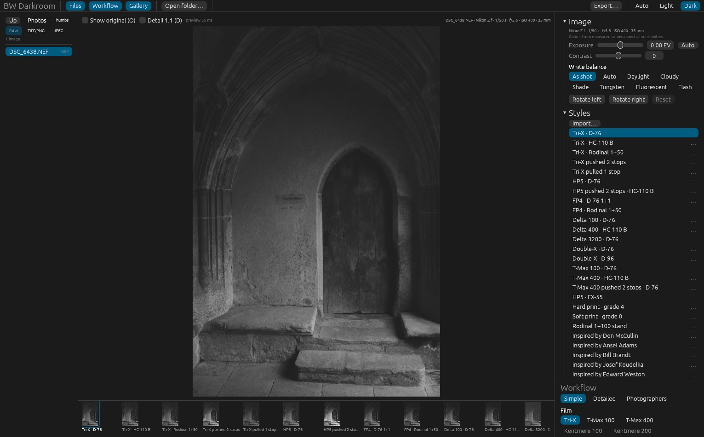

# BW Darkroom



A black-and-white photographic emulation engine in Rust, with a command-line tool and a
desktop app. Film, developer and processing are modelled as separate components that
interact through a simulated negative; printing is a separate stage on that negative.

> **Status:** early prototype. Film and developer parameters are **illustrative**
> placeholders, not yet fitted to manufacturer sensitometry. Product names describe the
> intended target only. See [design 0001](docs/design/0001-negative-simulation-model.md).

**Using the app:** see the [user guide](docs/USER_GUIDE.md).

## Layout

| Path | Contents |
|---|---|
| `crates/bw-core` | Planes, film geometry, monotone curves, deterministic noise, blur |
| `crates/bw-film`, `crates/bw-developer` | Film stocks; developer behaviour and processing conditions |
| `crates/bw-negative` | Negative simulation: exposure, development, adjacency, grain; development-time table |
| `crates/bw-darkroom` | Minimal printing |
| `crates/bw-profiles` | Styles (film + developer + process + print) |
| `crates/bw-io` | Image loading and export (TIFF, JPEG, PNG) |
| `crates/bw-raw` | Camera raw input (NEF, DNG, ARW) via LightCraft's `lightcraft-raw`; exposure, white balance, highlights |
| `apps/bw-cli` | `bw` command-line tool (`bw variations`) |
| `apps/bw-desktop` | `bw-darkroom` desktop app (egui) |
| `data/development` | Development times: raw Massive Dev Chart extract and the curated table |
| `tools/curate_times.py` | Rebuilds `times.csv` from the raw extract |
| `docs/` | Design and source research |

## Build and run

Requires the Rust toolchain pinned in `rust-toolchain.toml` (installed automatically by rustup).

```sh
cargo test --release                            # all tests
cargo run --release -p bw-desktop -- ~/Pictures # desktop app (optional folder or image)
cargo run --release -p bw-cli -- variations --input chart --out out/chart
```

### macOS app

```sh
tools/package-macos.sh   # → dist/BW Darkroom.app and dist/BW-Darkroom-<version>-arm64.dmg
```

The app is ad-hoc signed, not notarised: on another Mac, open it the first time with
right-click → Open. Set `SIGN_IDENTITY="Developer ID Application: …"` to sign it properly,
then notarise the DMG with `xcrun notarytool` and `xcrun stapler`.

Nikon High Efficiency (HE/HE★) NEFs are not supported; use lossless compressed NEF.
Set `BW_RAW_SAMPLE=/path/to/file.NEF` to include a real raw file in `cargo test`.

After editing `data/development/mdc-times.csv`, run `python3 -I tools/curate_times.py`.

## Versioning

The project uses [semantic versioning](https://semver.org): `MAJOR.MINOR.PATCH`, from
`[workspace.package] version` in `Cargo.toml` — the one place the version is set. The
desktop app's About window (BW Darkroom ▸ About BW Darkroom), export recipes and the macOS
bundle all read it; builds also embed the git commit, e.g. `0.2.0 (cf32c9d)`.

Before 1.0.0, a minor release adds features or makes breaking changes and a patch release
fixes bugs. To release, with everything committed:

```sh
tools/release.sh minor            # or patch / major; add --dry-run to preview
git push && git push origin v0.2.0
```

The script bumps the version, turns the changelog's Unreleased section into a dated
release, commits, and creates an annotated `vX.Y.Z` tag with the release notes.

## Licensing

| Part | Licence |
|---|---|
| `crates/bw-core` | MIT ([LICENSE-MIT](LICENSE-MIT)) |
| All other crates, `apps/bw-desktop`, `apps/bw-cli`, and plugins | Apache-2.0 ([LICENSE-APACHE](LICENSE-APACHE)) |

Each crate's `Cargo.toml` states its licence. The About window lists every third-party
component compiled into the app with its licence (`tools/gen_licenses.py` regenerates the
list; the packaging script runs it). New crates and plugins default to
Apache-2.0 through the workspace setting.

Third-party code keeps its own licence: `lightcraft-raw` and its supporting crates are
MIT OR Apache-2.0. The development-time data in `data/development/` is compiled from the
Massive Dev Chart (Digital Truth) and is not covered by this project's licences.

## Data sources

Development times come from the Massive Dev Chart (Digital Truth), read from Internet
Archive snapshots; each raw row links its source. Kodak and Ilford data-sheet findings are
in `docs/research/`.
